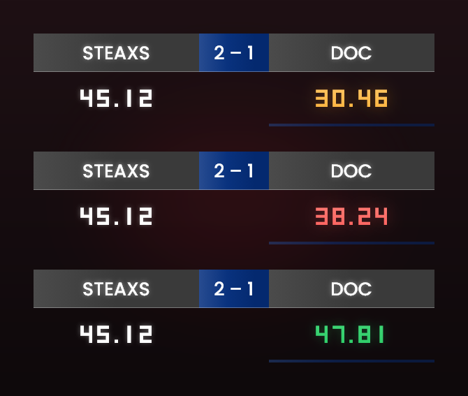
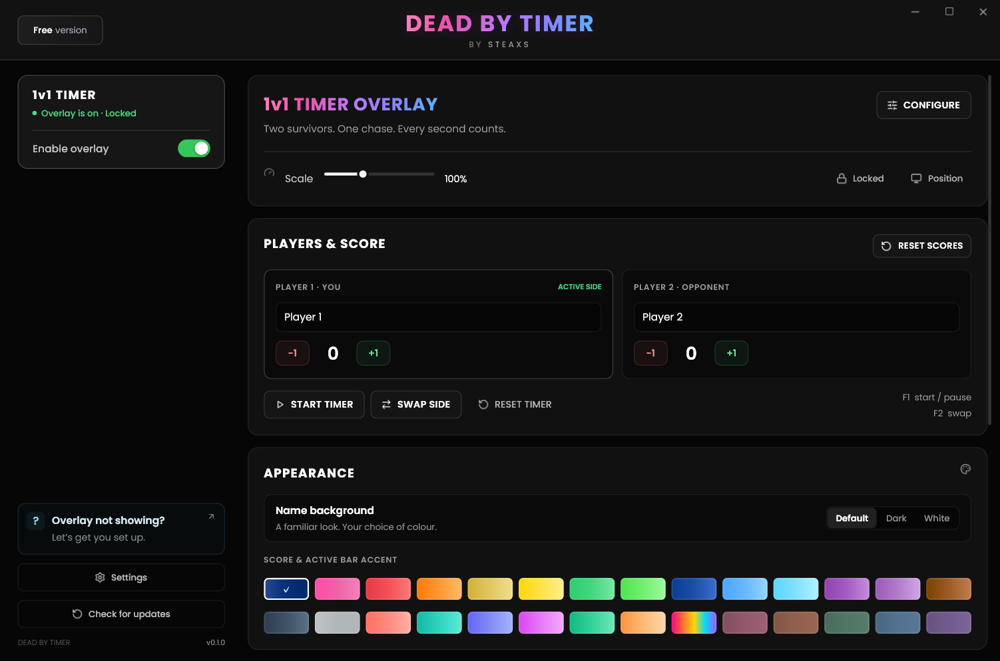

# Dead by Timer

**The free 1v1 chase timer for Dead by Daylight.**

[**Download for Windows**](https://github.com/steaxss/deadbytimer-v2/releases/latest)

Windows 10 / 11 · 64-bit

Timer by [STEAXS](https://x.com/steaxsDBD) & [DOC](https://x.com/DocDBD) · [Join the community](https://discord.com/invite/aVdT8rRJKc)

## Your next chase, timed

Start or pause your timer, swap sides and compare chase times without leaving your game. Keep both players' names and scores on screen, with shortcuts for your keyboard, mouse or controller.

The active timer turns orange as you approach your opponent's time, flashes red in the last ten seconds and turns green when you beat it.

## Make it yours

Choose your colours, adjust the size and position the overlay on your preferred screen. Lock it before playing so clicks pass through to your game. Capture the overlay in OBS for your stream.

## Get started

1. Download the **Setup.exe** from the [latest release](https://github.com/steaxss/deadbytimer-v2/releases/latest).
2. Run the Setup and open **Dead by Timer**.
3. Enter the player names and choose your shortcuts in **Configure**. By default, **F1** starts or pauses the timer and **F2** swaps sides.

If the overlay does not appear in game, open **Overlay not showing?** in the app for help.

Published updates are required. When a new version is detected, the timer pauses and the entire application remains locked until you install the update. Choose **Download update**, then **Install and restart**. Your settings are kept during updates. Installation requires Windows administrator approval.

## Community

For help, suggestions and premium overlays, join the [DBD Overlay Tools Discord](https://discord.com/invite/aVdT8rRJKc). Dead by Timer stays free.

Third-party licence notices are included with the application.

Dead by Daylight is a trademark of Behaviour Interactive. This fan-made tool is not affiliated with or endorsed by Behaviour.

